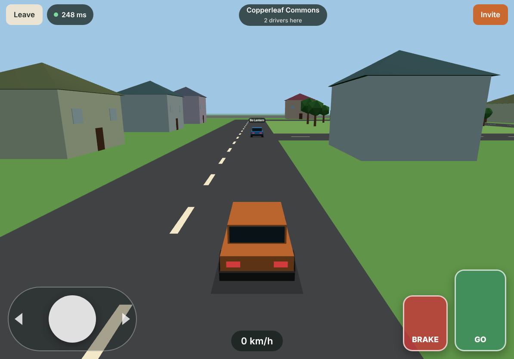

# Guildhood

An original multiplayer neighborhood car-and-Guild game for iPad, played in Safari. Players create
an account (email + password, verified by email), choose a username, display name, and avatar, add
friends by friend code, and drive together through a small shared neighborhood on an
authoritative game server. Guilds, racing, the shop, and territory arrive in later phases.



**Phases done: 1 "Join and drive" and 2 "Accounts, profiles, and secure access."** Neither has
been tested on physical iPads yet. Status, limitations, and the next task:
[docs/phase-backlog.md](docs/phase-backlog.md) and [docs/PHASE-1.md](docs/PHASE-1.md).

## Quick start (two iPads on your Wi-Fi)

Needs Docker Desktop and Node.js 22.12+ on one computer.

```bash
npm ci
npx supabase start
npm run lan
```

Open the printed `http://<computer>.local:5173` address on each iPad and create an account (codes
from the confirmation emails appear in the terminal). Full instructions:
[docs/deployment.md](docs/deployment.md). Manual test checklists: [docs/testing-plan.md](docs/testing-plan.md).

## Documentation

| Document | Contents |
|---|---|
| [docs/architecture.md](docs/architecture.md) | Engine, transport, server authority, data flow, reconnect behavior |
| [docs/authentication.md](docs/authentication.md) | Auth state machine, provider and redirect configuration, email templates, local email testing, session storage |
| [docs/account-deletion.md](docs/account-deletion.md) | Deletion flow, data policy, retained records, credential handling |
| [docs/database-schema.md](docs/database-schema.md) | Tables, functions, migrations, rollback |
| [docs/security.md](docs/security.md) | Trust boundaries, access matrix, restrictions, logging |
| [docs/ipad-input.md](docs/ipad-input.md) | Touch, keyboard, safe areas, accessibility |
| [docs/testing-plan.md](docs/testing-plan.md) | Automated test inventory and results, manual iPad checklists |
| [docs/deployment.md](docs/deployment.md) | Run locally, on Wi-Fi, and (prepared) in the cloud |
| [docs/phase-backlog.md](docs/phase-backlog.md) | Phase status, outstanding issues, Phase 3 handoff |
| [docs/PHASE-1.md](docs/PHASE-1.md), [docs/PHASE-2.md](docs/PHASE-2.md) | Phase reports |
| [ASSET-LICENSES.md](ASSET-LICENSES.md) | Asset and license manifest |

## Stack

TypeScript everywhere. Client: Vite + Three.js, touch-first, landscape, safe-area aware. Game
server: Node 22 + `ws`, fixed 30 Hz authoritative simulation shared with client-side prediction.
Backend: Supabase (Auth, Postgres with row level security, Realtime, Edge Functions). Hosting target: GitHub Pages
for the client, a container host (Fly.io config included) for the game server, Supabase Cloud.
